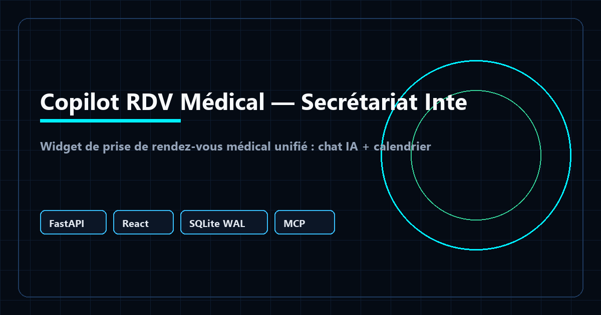
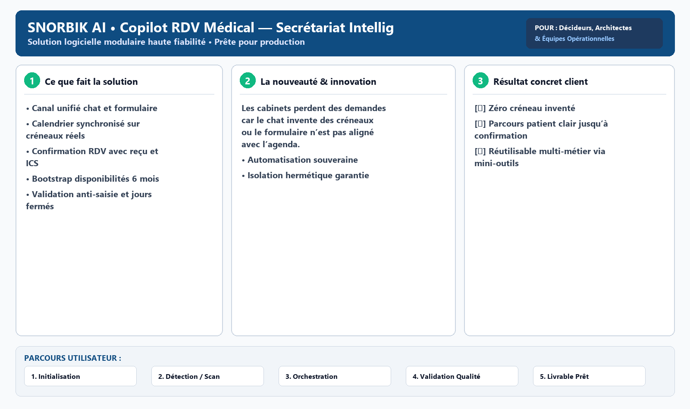

# 🏥 Copilot Médical 24/7 — Secrétariat Intelligent Souverain
### De vos outils existants à votre secrétariat médical autonome, déployé en 48 Heures par SNORBIK Studio

> **12 à 25 interruptions téléphoniques par jour en consultation : libérez votre temps médical.**  
> **Copilot Médical 24/7** accueille vos patients à l'écrit et à la voix, synchronise vos disponibilités réelles sur 6 mois et confirme chaque rendez-vous avec reçu officiel et fichier calendrier `.ICS` — en totale conformité **RGPD Santé**.

---

## 🎯 Bénéfices Métiers Immédiats (Pourquoi nos Cabinets l'Adoptent)

- **Disponibilité Continue 24h/24 et 7j/7 :** Zéro appel manqué le soir, le week-end ou pendant les consultations.
- **Expérience Patient Inclusive (Écrit & Vocal) :** Interaction naturelle accessible aux seniors et aux personnes en situation de handicap, avec réponses claires, aérées et empathiques.
- **Parcours Guidé en 4 Étapes Réelles :**
  1. **Qualification du motif** (consultation, suivi, certificat, détection et redirection immédiate vers le **15 SAMU** en cas d'urgence vitale).
  2. **Choix sur créneaux réels** (calendrier synchronisé sur 6 mois, zéro double réservation, jours fermés automatiquement protégés).
  3. **Collecte sécurisée des coordonnées** (vérification téléphone et validation stricte e-mail).
  4. **Confirmation instantanée** (reçu horodaté, e-mail de confirmation et ajout 1-clic `.ICS` dans l'agenda du patient).
- **Continuité Garantie Hors-Quota :** Un canal manuel direct prend instantanément le relais sans jamais bloquer la prise de rendez-vous.

---

## 🛡️ Souveraineté & Conformité RGPD Santé (3 Options de Déploiement)

Parce que le secret médical n'est pas négociable, **Copilot Médical 24/7** s'adapte exactement à votre niveau d'exigence :

1. **Option 1 — 100% Local (On-Premise) :** Modèles IA exécutés sur votre propre machine ou serveur de cabinet, zéro donnée sortante.
2. **Option 2 — VM Dédiée Souveraine :** Hébergement privé isolé en Europe avec base de données chiffrée et zéro mutualisation.
3. **Option 3 — Gateway RGPD Cloud :** Passerelle sécurisée avec anonymisation préalable et contrôle d'accès strict.

---

## 📊 Infographie Commerciale & ROI

---

## ⚙️ Architecture de Haut Niveau (20% Technique)

- **Cockpit React / TypeScript Split-Screen :** Chat conversationnel intelligent synchronisé en temps réel avec le panneau calendrier et le formulaire patient.
- **Cerveau Universel MCP (#32) :** Assemblage déterministe du contexte métier, zéro hallucination horaire et respect strict des règles déontologiques du cabinet.
- **Protocole MCP Hybride Modulaire :** Connecteurs découplés pour l'agenda réel, l'envoi d'e-mails `.ICS` et la mémoire de session sécurisée.

---

## 🌐 Démonstration & Contact

- **Site officiel :** [https://snorbik.com](https://snorbik.com)
- **Réalisations & Démo interactive :** [https://snorbik.com/projects/copilot-rendez-vous-medical](https://snorbik.com/projects/copilot-rendez-vous-medical)
- **Studio :** SNORBIK Studio — *AI Product Factory (Déploiement accéléré en 48 Heures)*

---
*Vitrine publique certifiée sans secret ni donnée sensible (`STANDARD_SHOWCASE_ET_SECRETS.md`).*
